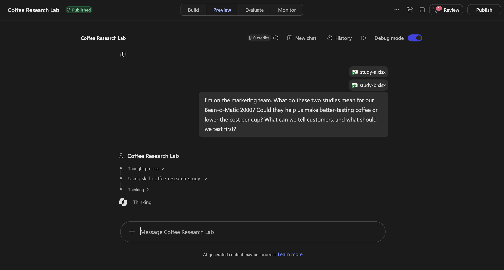
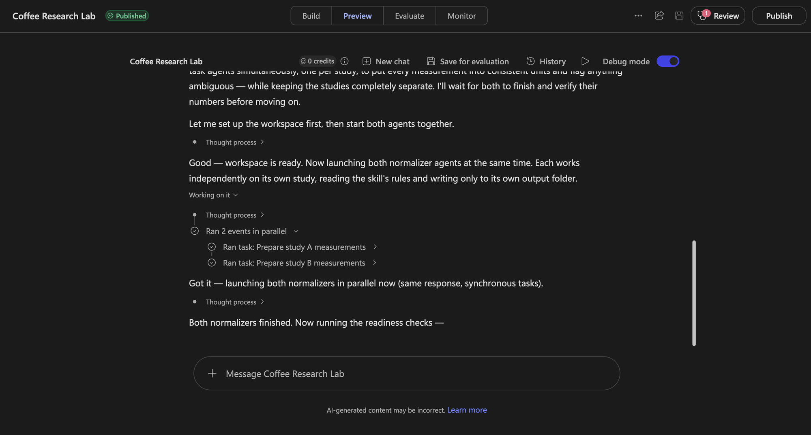
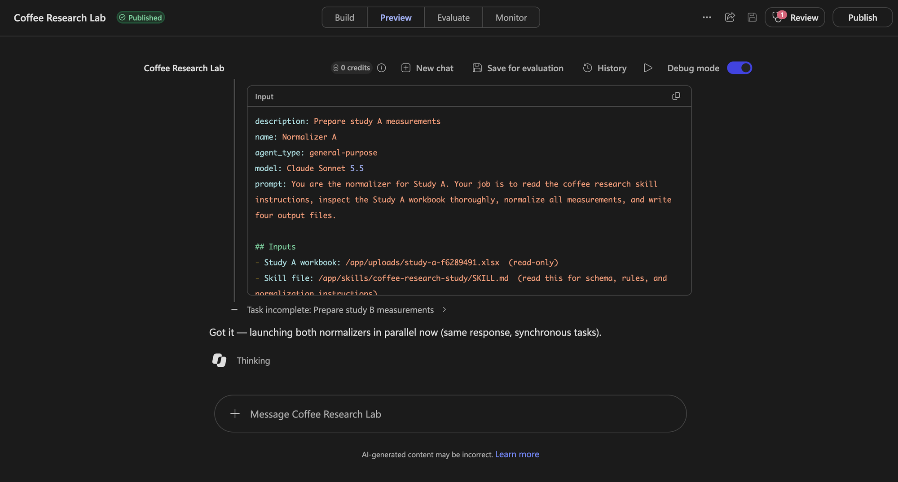
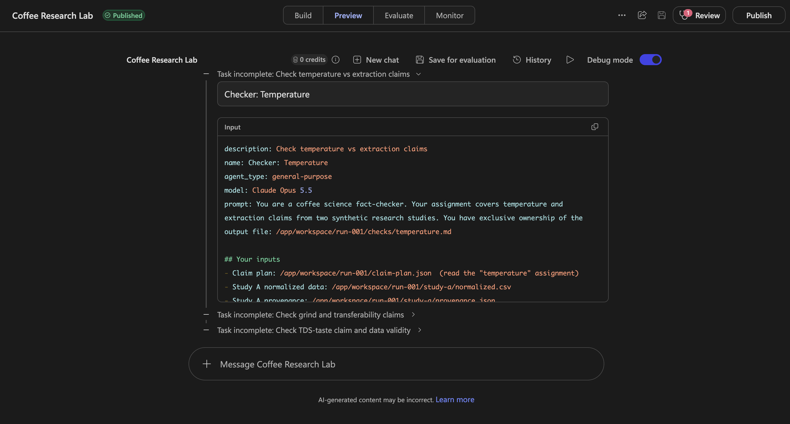
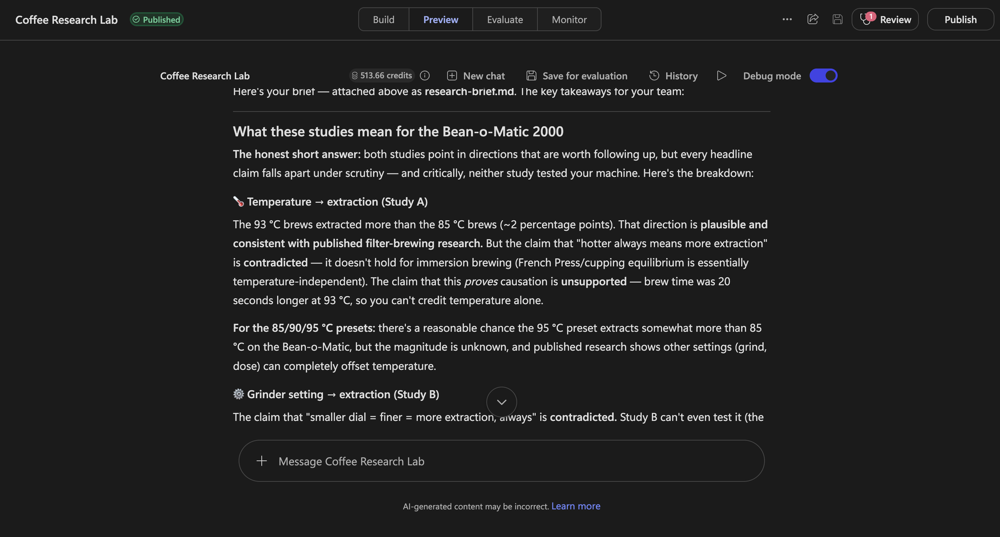

# Coffee Research Lab

This educational sample shows how
[Copilot Studio task agents (preview)](https://learn.microsoft.com/en-us/microsoft-copilot-studio/agents-experience/task-agents-overview)
can turn two messy Excel studies into a practical product brief. Follow the
conversation to see why the agent delegates work, uses sandbox files, and chooses
different models along the way.

| Task-agent benefit | In this demo |
| --- | --- |
| **Parallel execution** | Prepare both studies together, then research three independent questions together. |
| **More room in the main context** | Keep detailed workbook analysis and research in separate task contexts; return short summaries and file paths. |
| **Sandbox file access** | Task agents can read and write files in the same sandbox, including earlier tasks' outputs. |
| **A model per task** | Request Sonnet for preparation and Opus for scientific checking, where available. |

## Start with the product question

Import the solution, open **Coffee Research Lab** in Preview, and start a new
chat. Attach both [study A](supporting/study-a.xlsx) and
[study B](supporting/study-b.xlsx), then ask:

> I'm on the marketing team. What do these two studies mean for our
> Bean-o-Matic 2000? Could they help us make better-tasting coffee or lower
> the cost per cup? What can we tell customers, and what should we test first?

The user asks for an outcome, not a workflow. The agent's skill supplies the
research process and the fictional brewer's specifications. Both studies contain
synthetic data: this is a demonstration, not evidence for real product claims.

## Prepare the studies in parallel

Before researching claims, the agent needs consistent measurements. The workbooks
use different layouts and units, with missing values and duplicate observations.
It launches **two task agents at the same time**, one per study, because neither
needs the other's results to prepare its own data.

Each task has a **separate context window** for inspecting its workbook and
working through conversions. Those detailed intermediate steps do not fill the
main agent's conversation, leaving more of its context available for the user's
question and the final answer. Tasks return file paths and short summaries.

The preparation tasks request **Claude Sonnet 5.5**. Task agents can access files
in the sandbox directly: each receives the paths to its original workbook and
the skill containing its instructions.

## Check claims in parallel

Task agents **directly access the same sandbox files**. Each study task saves
prepared measurements, source references, and notes in its own directory.
Researchers read those outputs and write separate findings files, avoiding
competing edits. Separate contexts are not security boundaries.

After both studies pass calculation and source-reference checks, the main agent
launches **three research tasks in parallel**: temperature and extraction,
grinder-setting transferability, and strength versus taste. These tasks rely on
**Web IQ** to find and read scientific sources on the web.

These tasks request **Claude Opus 5.5**, demonstrating how scientific review can
use a different model from workbook preparation.

We explicitly choose models here to demonstrate how task agents work. It is
also perfectly fine to let Copilot Studio select a model based on what each
task needs to do. Available choices depend on your environment's
[model access](https://learn.microsoft.com/en-us/microsoft-copilot-studio/agents-experience/authoring-agent-model-availability).

## Bring the findings back to the product

After all checks finish, the main agent writes **one research brief**: promising
directions, what the evidence does not establish, and tests to run on the
Bean-o-Matic 2000. Calculations and detailed references belong in the appendix,
not in the marketing team's way.

The main agent coordinates and combines the work instead of repeating every
analysis. These are task assignments within **one agent**, not five separately
published agents. Expand the Task entries in Preview to inspect assignments,
file paths, requested models, and returned results.

## Before using the sample

You need an early-release Power Platform environment with task-agent support,
solution-import permissions, the required model access, sandbox Python/workbook
tools, and Web IQ enabled by your organization's policies. The exported
main model is `Sonnet46`. No custom connector is required; importing does not
publish or share the agent.

This is not a production-ready research system. Use authorized data only.
Instructions keep study files in the sandbox, use generic scientific web queries,
and prohibit running workbook code or macros. Higher extraction alone proves
neither better taste nor lower cost; findings need human review.

**Validation:** a demo run completed and its returned measurements
passed the arithmetic checker. Fresh-environment import testing remains pending.
Screenshots show a development run, not a performance benchmark.
