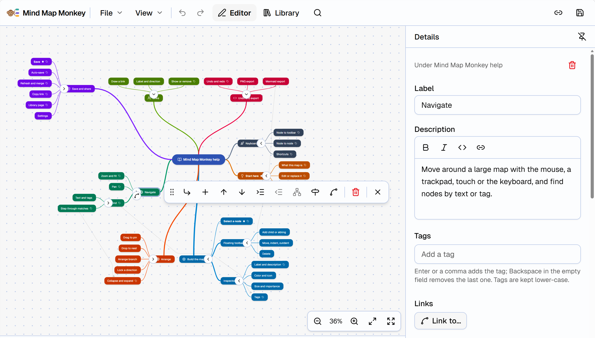

# Mind Map Monkey

Mind Map Monkey is a sample managed app for creating and editing mind maps as
Mermaid `.mmd` files in OneDrive for Business. It is intended for learning and
adaptation, not as a production-ready application.

The built-in help map shows the editor's features.

## Using the app

Create a map or open an existing Mermaid mind map from OneDrive. Add and
rearrange branches, descriptions, tags and links, then save the map back to
OneDrive. New nodes open in the editor so you can name them immediately. You
can import Mermaid code or a file, export Mermaid or a PNG, and use the built-in
help map to explore the editor.

The app can copy a link to a map. Recipients need access to both the app and
the OneDrive file; copying the link does not grant access.

## Data and permissions

Connect your own OneDrive for Business account. No list, database table or
pre-existing map is required. The account needs permission to list folders and
read, create, update, move and delete files in the folders used for maps.

The app saves maps as plain-text `.mmd` files. When saving a file in your own
OneDrive, it creates and moves temporary lock files beside the map and deletes
them after use. The lock is advisory: other applications do not respect it,
and shared files from another drive do not use it.

Unsaved, unlinked drafts and their names are stored in browser local storage
to survive a refresh. Preferences, recent file references and folder information
are also stored in the browser. On a shared computer, clear site data after use.

## Limitations

- The save lock is not an atomic write; concurrent edits can still race. The app
  checks for changes and offers a merge when it detects them.
- Mermaid export changes brackets in labels to spaces, and root-node importance
  does not survive a save and reload.
- Large maps and physical touch devices have not been fully tested. Adding and
  importing enforce limits of 2,000 nodes and 64 levels, but a merge can exceed
  the node limit. Saved files are limited to 1 MB.
- Browser and host permissions can affect clipboard, drag-and-drop and warnings
  about unsaved changes.

See `KNOWN-ISSUES.md` in the app source for further details.

## Make it your own

Adapt the built-in help map, visual styling or editor controls in the source.
The optional [Mind Map Monkey Cowork skill](https://github.com/scottdurow/mind-map-monkey/tree/main/skills/mind-map-monkey)
is installed separately; it is not included in the gallery installation.
