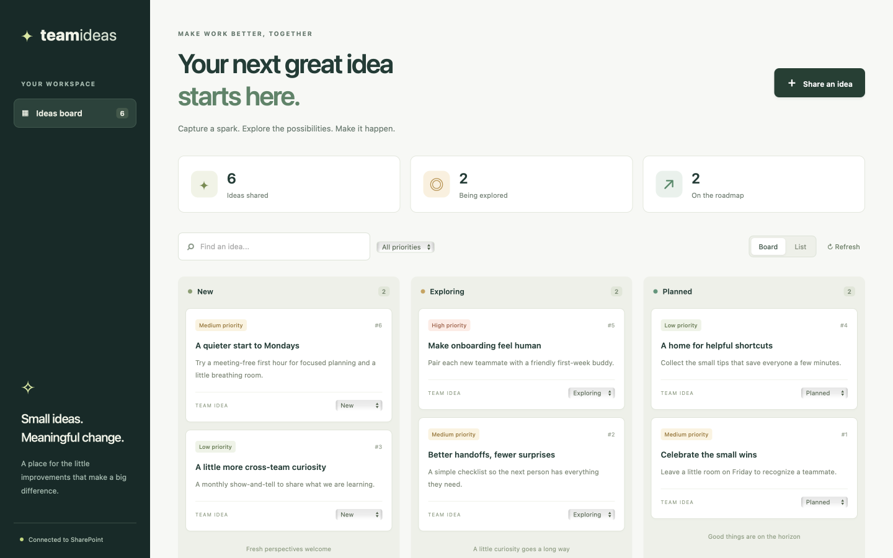
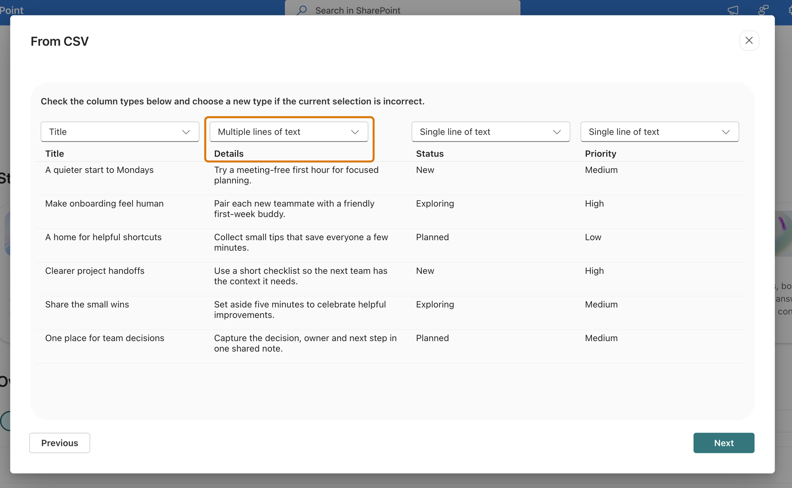

# Team Ideas Board

A calm, responsive workspace for turning small suggestions into meaningful team
improvements. Capture ideas, search and filter by priority, switch between board
and list views, and move ideas through **New → Exploring → Planned**.

This is a clean MIT-licensed starter using the public first-party Vite/React
Managed Apps scaffold conventions. It contains no training app source, tenant
addresses, connections, deployment identity, or private records.

## Screenshot

The image is illustrative and uses synthetic ideas, not a live SharePoint
connection.

## Create your SharePoint list

In the SharePoint site you want to use, choose **New → List → Blank list**.
Name it **Team Ideas** (or **team-ideas**). Keep the built-in **Title** column.
Use **Add column** to create these columns with exactly these initial names:

| Column name | SharePoint column type | Settings |
| --- | --- | --- |
| Title | Single line of text | Required |
| Details | Multiple lines of text | Plain text, optional |
| Status | Single line of text | Default New; required. Values: New, Exploring, Planned |
| Priority | Single line of text | Default Medium; required. Values: Low, Medium, High |

Keep these display names so the app can identify the columns. Do not use rich text
for Details. Status and Priority deliberately use text columns to keep the generated
client contract simple; the app offers only the listed values. You need permission to
read, add, and edit items.

### Create from CSV instead

Microsoft Lists also supports **New list → From CSV**. Choose a file below
and name the list **Team Ideas** or **team-ideas**:

- [Blank data template (CSV)](supporting/team-ideas-empty.csv): column headers
  only, with no sample ideas.
- [Synthetic sample ideas (CSV)](supporting/team-ideas.csv): the same headers
  plus six fictional ideas.

Use the populated file if the import wizard requires data rows. You can remove
those six sample items afterward for an empty board.

CSV files contain data, not SharePoint column settings. Review and change the
column types manually during import or afterward; no app registration or
provisioning script is needed.

On the column-type preview, keep **Title** as **Title**, and **Status** and
**Priority** as **Single line of text**. Change **Details** to **Multiple lines
of text** (highlighted below). The preview should match the screenshot.

Choose **Next** and finish creating the list. In
**List settings → Columns**, make Title, Status, and Priority required, set
Status's default to **New** and Priority's to **Medium**, and keep Details
optional and plain text.

Save the list to the SharePoint site you intend to connect, not **My lists**.
Personal lists belong to a different site and will not appear when you select
your team site in the CLI.

CSV imports can assign internal names such as `field_1` instead of `Details`.
The app reads the native CLI's generated schema during its local build and maps
the five display names above to their actual internal names. Only that small
field map is saved in `src/ideaFields.json` for hosted builds; the native schema
and generated clients are not rewritten. If you change columns later, refresh
the binding with the native CLI and rebuild before saving the source.

## Scope and limitations

The board loads at most 200 ideas per refresh, newest first within that returned
set. Search and priority filters operate on loaded ideas, not the entire list.
Each status update is a normal SharePoint update, not a transaction or conflict
resolution system. This starter is not intended for large backlogs or concurrent
workflow processing. Errors are visible; failed writes are not presented as
successful and are never automatically retried.

The UI renders connector text as text, never raw HTML. Fonts use local/system
fallbacks without external font requests. App data access remains subject to your tenant's licensing,
permissions, and connector policies.

The starter pins Vite to a patched release and overrides transitive Zod to
patched 4.x releases because the first-party runtime packages currently pin an
older version. Revisit the override when those packages update their dependency.

## Make it your own

1. Change the heading or colors in `app/src/App.tsx` and `app/src/style.css`.
2. Adapt the board's statuses and priorities for your team's workflow.
3. Keep any additional SharePoint columns aligned with the app's types, form,
   and selected fields in `app/src/ideas.ts`.

## Architecture

React UI → native generated `TeamIdeasService` (or `Team_ideasService`) → Managed Apps connector runtime
→ your SharePoint **Team Ideas** list. Data stays in your list.
