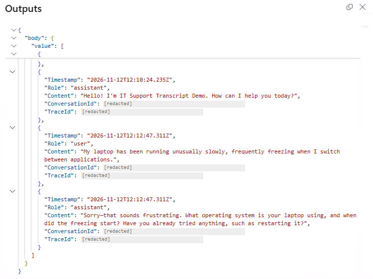

# Transcript Capture with a Pre-Tool Hook

Attach an available conversation snapshot to a support ticket at the moment an agent calls a tool. This sample uses a **Pre tool use** hook on a Copilot Studio agent powered by the GitHub Copilot harness. The hook receives the current conversation ID directly, queries environment-level Azure Application Insights telemetry, and supplies the result as tool arguments.

There is no connected helper agent and no conversation-ID reverse lookup. This is a separate alternative to the older connected-agent Runtime Transcript Capture sample.

> **Configure before enabling.** Both workflows are packaged disabled, automatic agent publication is off, and the Azure resource and query-scope values are nonfunctional placeholders. The ticket tool is a simulation: it never writes to a real ticketing system. Review the solution and its data access before importing it.

## Included Assets

| Asset | Purpose |
| --- | --- |
| **IT Support Transcript Demo** | Provides generic IT troubleshooting and routes explicit ticket requests to a skill |
| **log-support-ticket** skill | Submits a demo ticket with existing conversation details, without additional intake questions; handles receipt and capture limitations |
| **Attach available transcript** hook | Runs before **Log ticket** only |
| **Capture transcript before ticket** workflow | Queries the current conversation and returns replacement tool arguments |
| **IT Support - Log ticket** workflow | Returns a simulated ticket receipt, whether or not a transcript was captured |
| **Azure Monitor Logs** connection reference | Binds the capture query to an importing maker's approved connection |

## How It Works

An explicit ticket request routes to the **log-support-ticket** skill, which uses existing details without further intake or confirmation questions. Before **Log ticket** runs, its hook queries the current conversation's available user/assistant text and injects a transcript JSON string and conversation ID into the tool arguments. The tool returns a `DEMO-...` receipt with `Simulated` status.

Missing metadata, empty results, capture failures, or oversized results must not block the demo ticket. Snapshots are limited to 500 rows and 100,000 serialized characters. `transcriptAttached: true` means data was supplied, not that every turn was captured. Transcript text is treated as untrusted data.

## Example Result

The capture action returns available text rows with `Timestamp`, `Role`, `Content`, `ConversationId`, and `TraceId`:

Screenshot from a real demo run, cropped to the Outputs panel with conversation and trace identifiers redacted.

## Prerequisites

- A target Copilot Studio environment that supports GitHub Copilot-harness agents, agent skills, modern workflows, and Pre tool use hooks. These capabilities are subject to preview availability and licensing.
- Environment-level Application Insights export configured for the target environment. Export configuration is external to this solution; importing the solution does not provision Azure resources or enable telemetry.
- An Application Insights resource receiving the target environment's `dependencies` telemetry and an Azure Monitor Logs connection with least-privilege permission to query that resource.
- Permission to import unmanaged solutions and configure/publish the imported agent and workflows.
- A model available to the target environment. The native export retains its source model selection; verify or select a supported model in Studio before publishing.

See [environment-level telemetry setup and limitations](https://learn.microsoft.com/en-us/microsoft-copilot-studio/advanced-environment-level-agent-telemetry) and [hooks documentation](https://learn.microsoft.com/en-us/microsoft-copilot-studio/agents-experience/hooks-overview).

## Enable the Solution

Import the unmanaged solution into your target environment and bind the Azure Monitor Logs connection references to an approved connection. After importing:

1. Enable **IT Support - Log ticket**.
2. Open **Capture transcript before ticket** and update **Run query and list results**:
	- Select your Azure subscription, resource group, and Application Insights resource; keep resource type **Application Insights**.
	- Replace `REPLACE_WITH_ENVIRONMENT_ID` in the query with your Power Platform environment ID. The agent ID comes from the hook automatically.
	- Set **Time range type** to **3**, using **Enter custom value** if needed.
	- Save and **publish the flow**.
	- Open `https://make.powerautomate.com/environments/[EnvID]/flows/[FlowID]/details`, then **Run-only users > Edit > Connections Used > Azure Monitor Logs > Use this connection...**. Choose the approved connection and save. Use the capture flow's Power Automate details ID for `[FlowID]`, which can differ from its Copilot Studio authoring ID.
	- **After any changes to this flow, update the run-only connection setting again.** Chat users should not have to supply their own Azure Monitor connection.
3. Publish **IT Support Transcript Demo** to **Microsoft 365 Copilot**, granting access only to the intended users. Chat with the agent, discuss an issue, and ask it to log a ticket. Open **Capture transcript before ticket > Activity**, select the run, and inspect **Run query and list results > Outputs > body > value**.

Before publishing, verify that **Attach available transcript** is a **Pre tool use** hook scoped to **Log ticket** and invokes **Capture transcript before ticket**. Leave the tool's optional `transcript` and `conversationId` inputs empty for the hook. Check that the selected model is available in your environment.

### Placeholder Reference

| Packaged value | Replace with |
| --- | --- |
| `00000000-0000-0000-0000-000000000000` | Azure subscription ID |
| `REPLACE_WITH_RESOURCE_GROUP` | Azure resource group |
| `REPLACE_WITH_APPLICATION_INSIGHTS_RESOURCE` | Application Insights resource name |
| `REPLACE_WITH_ENVIRONMENT_ID` | Target Power Platform environment ID used by `env.id` |

Configure through the native designer so the executable workflow and saved graph remain synchronized. Keep the environment ID explicit; no manual agent-ID configuration is needed. A hook authoring ID is not interchangeable with telemetry `gen_ai.agent.id`.

## Limitations and Safety

- **Best-effort telemetry, not a live-transcript API.** Export can be delayed, lost, or truncated. The current request can be absent, and the pre-tool snapshot cannot include the subsequent ticket result. No asynchronous enrichment worker is included.
- **Timestamp ordering is unchanged.** Messages can share span timestamps, and a greeting can appear after a user/reply pair. This is not an exact chat chronology or compliance record.
- **Demo only.** No real ticket backend or durable archive is included. Missing capture does not block the simulated ticket; a hook is not an authorization boundary.
- **Privacy and access.** Conversation text can be sensitive. Restrict telemetry and run-history access and define retention policies. For production, add an authorized backend, validation, and idempotency.
- **Authoring compatibility.** Use Studio for hook management and verify the binding after import. Full PAC workspace pushes did not safely preserve hooks in the versions tested; preserve the native expression-returned hook response fields.

The gallery rebuilds the downloadable ZIP from `solution/`. Documentation and example images remain outside that payload. Review the native source before import.